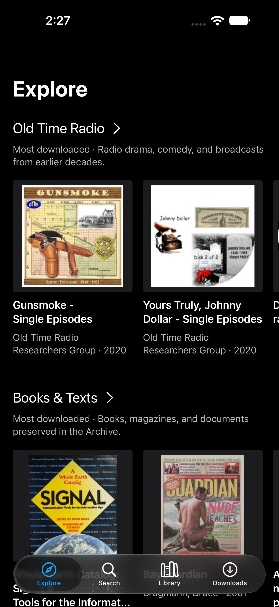
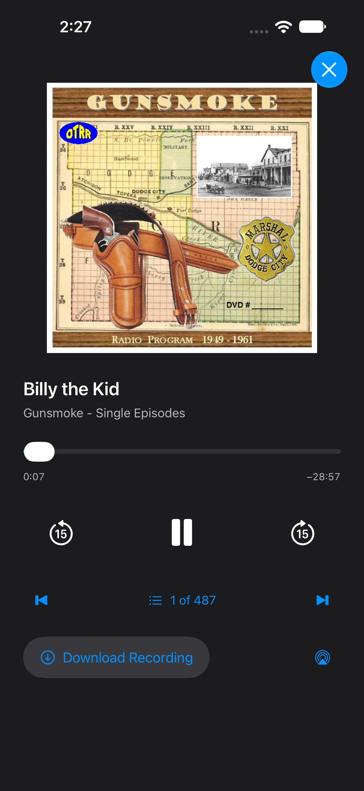

# Funston

An iPhone and iPad app for Internet Archive: old radio, live music, films, books and scanned magazines, in a native UIKit shell that works with VoiceOver.

<p>


</p>

## What it does

Explore shows the most downloaded items from a few collections, and Search covers all of Internet Archive, filtered by media type. On iPad the app becomes a three-column split view.

Multi-track items play as a queue. A mini-player stays open while you browse, the Lock Screen shows the item's artwork, and each recording remembers where you stopped.

CarPlay offers recent listening, saved audio, offline downloads, and radio/music browsing through the same player. Device builds require Apple's CarPlay audio entitlement; see [CarPlay setup and verification](Docs/CarPlay.md).

Books that come with their own EPUB, such as Project Gutenberg's, open in Funston's own reader: it unpacks the book, parses the chapters, lays the text out with TextKit and draws it itself, with no web view, so it follows your text size, remembers your place by EPUB CFI, and gives VoiceOver one element per paragraph that keeps its place across page turns. PDFs open in PDFKit with search and a remembered page. For scanned books, Page Text recognizes the page on the device instead of trusting Internet Archive's OCR, reading multi-column magazine pages column by column in whole paragraphs and tables row by row, and Reading options lets you pick the engine yourself.

MP4, M4V and MOV films play in the system player. MKV originals play through [ArchivePlayerCore](https://github.com/CamdenBopp/ArchivePlayerCore), with audio-track and caption menus. That path is experimental.

Library holds what you save and Downloads holds files for offline use. They're independent: removing a download doesn't unsave the item, and unsaving doesn't delete the file.

## Build

Requires Xcode 27 and [XcodeGen](https://github.com/yonaskolb/XcodeGen). The app targets iOS 18.

```sh
xcodegen generate
xcodebuild -project Funston.xcodeproj -scheme Funston -destination 'generic/platform=iOS Simulator' build
```

To run on a device, change `DEVELOPMENT_TEAM` and the `com.camden` bundle prefix in `project.yml` to your own. `Package.resolved` is committed; keep it to get the same dependency versions.

Tests:

```sh
xcodebuild test -project Funston.xcodeproj -scheme Funston -destination 'platform=iOS Simulator,name=iPhone 17 Pro' -only-testing:FunstonTests
```

`FunstonUITests` drive the live app against archive.org and need a network connection.

## Known gaps

- Fast scrolling through heavy scanned PDFs can show blank pages for a moment. [PDFScrollingPolish.md](Docs/PDFScrollingPolish.md) has the measurements and the experiments that didn't work.
- The MKV player hasn't been tested on a physical iPhone or under VoiceOver on a device. WebM, VOB and MPEG-TS aren't offered yet.
- Background downloads only run on a device. The Simulator uses an in-process session because its background transfer daemon fails; see [SimulatorDownloads.md](Docs/SimulatorDownloads.md).
- AirPlay and Picture in Picture for films come from the system player but haven't been checked on a device.
- EPUBs Internet Archive generated from a scan's OCR aren't offered as books; those open as PDFs with on-device recognition instead.

## How it's put together

UIKit owns navigation, the tab and split layouts, and every list. SwiftUI draws the item header and the full-screen audio player. The mini-player is [LNPopupController](https://github.com/LeoNatan/LNPopupController) 4.5.12, vendored with a one-file build fix described in [its provenance note](Vendor/LNPopupController/PROVENANCE.md). Playback, downloads, artwork caching and the SQLite store are the app's own. [ComponentDecisions.md](Docs/ComponentDecisions.md) explains the choices, and [ImplementationPlan.md](Docs/ImplementationPlan.md) is the product contract.

## License

MIT; see [LICENSE](LICENSE). Vendored code keeps its own license ([ThirdPartyNotices.txt](Funston/Resources/ThirdPartyNotices.txt)). Media and artwork from Internet Archive, including what appears in these screenshots, belong to their rights holders and aren't covered by this license.
